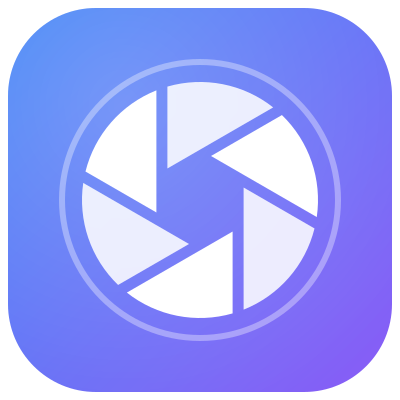

# ProLens

[](https://github.com/chago1991/prolens?tab=MIT-1-ov-file#readme)
[](https://github.com/chago1991/prolens/releases/latest)

<picture>
  
</picture>

ProLens is an independently branded, open-source Kubernetes IDE for macOS,
Windows and Linux. It manages and monitors Kubernetes clusters from a desktop
application: cluster dashboards, workloads, networking, storage and
configuration, a built-in terminal, Helm, and extensions.

<br clear="left">

## Relationship to Freelens and OpenLens

ProLens is a fork of [Freelens](https://github.com/freelensapp/freelens),
which is itself a fork of OpenLens. It keeps the code, the MIT license and the
copyright notices of the Freelens Authors and the OpenLens Authors, and follows
Freelens upstream.

What ProLens changes is its identity, so that both applications can be
installed side by side:

- the application is named ProLens, with its own icons and the application id
  `app.prolens.ProLens`;
- it keeps its settings in its own user-data directory (`ProLens`, or
  `ProLensDev` in development), separate from the one of Freelens;
- it registers itself for `prolens://` links. Links that start with
  `freelens://` still work when they are passed to ProLens, but ProLens does not
  register for them, so they keep opening Freelens.

ProLens runs Freelens-compatible extensions: the extension API is still
`@freelensapp/extensions`, and an extension declares the versions it supports
in the `freelens` field of its `engines`.

## Building from source

ProLens needs Node.js 24 and pnpm (the version pinned in `packageManager` of
`package.json`):

```sh
pnpm install
pnpm build          # build all packages and the application bundle
pnpm build:app:dir  # package the application into freelens/dist without an installer
pnpm start          # start the packaged application
```

`pnpm build:app` builds the installers for the current platform. See
[DEVELOPMENT.md](DEVELOPMENT.md) for the development loop and the checks to run
before a change.

## Requirements

Kubernetes 1.22 or later. Older clusters fall back to the bundled `kubectl`,
which may not work correctly; a different one can be set in Preferences.

## Downloads

ProLens is distributed only through the
[releases](https://github.com/chago1991/prolens/releases) of this repository.
There is no Homebrew cask, Flatpak, Snap, APT repository, AUR package, WinGet
or Scoop package for ProLens; the packages of those names install Freelens.
A release built without signing secrets is not code-signed or notarized, and
says so in its notes. Every release lists the SHA-256 of its files in
`ProLens-<version>-SHA256SUMS.txt`. ProLens tells you when a newer release is
available but does not update itself. How releases are made is described in
[docs/prolens/releasing.md](docs/prolens/releasing.md).

### macOS

macOS 13 or later is required. Download the DMG (disk image) or ZIP for arm64
(Apple silicon) or x64 (Intel). A release built without a Developer ID
certificate is signed ad-hoc only: the first time, open the app, then choose
**Open Anyway** in System Settings → Privacy & Security.

### Linux

Linux with GNU C Library 2.34 or later is required (Debian 12, Fedora 35,
Ubuntu 22.04 or newer, or a rolling release distribution). Download the DEB,
RPM or AppImage for x64 (x86_64) or arm64 (aarch64). The packages install
the `prolens` command and do not touch an installed Freelens.

The AppImage requires libz.so and libfuse.so.2 (`sudo apt install libfuse2
zlib1g-dev`) and runs with:

```sh
./ProLens*.AppImage --no-sandbox --ozone-platform-hint=auto --enable-features=WebRTCPipeWireCapturer --enable-features=WaylandWindowDecorations --disable-gpu-compositing
```

Extensions keep tokens and passwords in the desktop's secret store. On a
desktop the application does not recognise, such as sway, Hyprland or i3,
name it when you start the application: `prolens
--password-store=gnome-libsecret` (any Secret Service provider) or
`--password-store=kwallet6` (KWallet).

### Windows

Windows 10 or later is required. Download the installer (EXE) for x64 or
arm64. An unsigned installer is reported by SmartScreen: choose **More info**,
then **Run anyway**.

The terminal can run a WSL shell: set the shell to `wsl.exe` in the terminal
preferences. WSL 2 needs the mirrored networking mode (`networkingMode=mirrored`
under `[wsl2]` in `%UserProfile%\.wslconfig`, then `wsl --shutdown`).

## Development

Visit the [Development](DEVELOPMENT.md) document to see how to build the
application from source.
Check out the [Freelens Docs](https://freelensapp.github.io/docs/) to contribute to development or create your own extension.

## Extensions

Anyone can develop extensions for Freelens and many extensions previously used
with Open Lens have already been converted.
Visit the [Extensions](https://github.com/freelensapp/freelens/discussions/2291)
discussion to see them and write in the [appropriate
discussion](https://github.com/freelensapp/freelens/discussions/117) if you
also want to propose yours.

The skills for coding agents that create Freelens extensions and port v1
extensions to the v2 extension API are the `freelens` plugin of
[Claude Code](https://code.claude.com/docs/en/plugins), whose `SKILL.md` files
in [`plugins/freelens/skills`](plugins/freelens/skills) other agents read too.
Add the marketplace with `--sparse`, which checks out only the plugin instead
of the whole Freelens repository, then install the plugin from it:

```sh
claude plugin marketplace add freelensapp/freelens --sparse .claude-plugin plugins
claude plugin install freelens@freelens
```

`/freelens:create-extension` starts a new extension from a copy of
[freelens-example-extension](https://github.com/freelensapp/freelens-example-extension),
and `/freelens:port-extension-to-v2` ports an extension written for the v1
extension API.

## Community

Get updates about Freelens & keep in touch with our community

- Follow us on [LinkedIn](https://www.linkedin.com/company/freelensapp/)
- Follow us on [Bluesky](https://bsky.app/profile/freelensapp.bsky.social)
- Follow us on [X](https://x.com/freelensapp)
- Join our [Discussions](https://github.com/freelensapp/freelens/discussions)
- Chat on [Discord](https://discord.gg/NjKZERK95Y)
- Discuss on [Reddit](https://www.reddit.com/r/freelens/)
- Watch us on [YouTube](https://www.youtube.com/@Freelensapp)
- Open an [Issue](https://github.com/freelensapp/freelens/issues)

## Adopters

Freelens is used by many individuals, companies, and organizations.

We have created the [adopters](https://github.com/freelensapp/freelens/blob/main/ADOPTERS.md) file for anyone who would like to be part of the official list.

Anyone is welcome to request to be added to the official list by opening a dedicated Pull Request.

## Contributing

Anyone is welcome to collaborate to advance the Freelens project. Read
[CONTRIBUTING.md](CONTRIBUTING.md) to see how you can help.

<picture>
  <source
    media="(prefers-color-scheme: dark)"
    srcset="https://api.star-history.com/svg?repos=freelensapp/freelens&type=Date&theme=dark"
  >
  <source
    media="(prefers-color-scheme: light)"
    srcset="https://api.star-history.com/svg?repos=freelensapp/freelens&type=Date"
  >
  
</picture>

## Expenses and Donations

Anyone can support the Freelens project by making donations to cover
maintenance costs and invest in its development.

For more information, see our dedicated discussion: [Expenses and
Donations](https://github.com/freelensapp/freelens/discussions/2292)

## Fund an issue or earn money by developing

Anyone who wishes can also make targeted donations, funding their preferred issues alone or with others via [BountyHub](https://www.bountyhub.dev/en/bounties?repo=freelens).

At the same time, anyone who wishes can apply by doing PR to earn the bounty.

Features are, in any case, decided democratically according to the community's wishes and overseen by the Freelens core team.

For more information, see our dedicated discussion: [Fund an issue or earn money by developing](https://github.com/freelensapp/freelens/discussions/2293)

## The Freelens Teams

### Core Team

Each member of the core team is focused on specific roles. You can contact us
at any time according to them.

- [Roberto Bandini](https://www.linkedin.com/in/bandiniroberto/) - [@robertobandini](https://github.com/robertobandini) - Founder<br/>
  General organization management, relationships, product management, community, marketing, extensions ecosystem (review, catalog, strategy and development)
- [Piotr Roszatycki](https://www.linkedin.com/in/piotr.roszatycki) - [@dex4er](https://github.com/dex4er) - Maintainer<br/>
  Development direction, architecture and release management, extensions development
- [Mario Offertucci](https://www.linkedin.com/in/mario-offertucci-703113b6/) - [@mariomamo](https://github.com/mariomamo) - Maintainer<br/>
  UI, docs, extensions development
- [Leopoldo Capuano](https://www.linkedin.com/in/leo-capuano/) - [@leo-capvano](https://github.com/leo-capvano) - Maintainer<br/>
  GenAI solutions, extensions development

### Release Engineering Team

This team is responsible for driving Freelens releases forward, reviewing PRs, and making decisions about the architecture and technical roadmap under the supervision of the core team.

- [Piotr Roszatycki](https://www.linkedin.com/in/piotr.roszatycki) - [@dex4er](https://github.com/dex4er) - Maintainer<br/>
  Release Engineering Team Lead
- [Omar Alani](https://www.linkedin.com/in/omarluq/) - [@omarluq](https://github.com/omarluq) - Maintainer<br/>
  Release Engineering Team Member
- [Matías Roje](https://www.linkedin.com/in/matias-roje-carrasco/) - [@MatiasRoje](https://github.com/MatiasRoje) - Maintainer<br/>
  Release Engineering Team Member

The project is growing very quickly and everyone is welcome!

If you also want to be part of it, visit the [We want
you!](https://github.com/freelensapp/freelens/discussions/2297) discussion.

Or contact us at <freelens@freelens.app> for any questions or suggestions!

## License

This repository is a fork of [Open
Lens](https://github.com/lensapp/lens/tree/master), the core of [Lens
Desktop](https://k8slens.dev), with the aim of carrying forward its
open-source version.

Copyright (c) 2024-2026 Freelens Authors.

Copyright (c) 2022 OpenLens Authors.

[MIT License](https://opensource.org/licenses/MIT)
